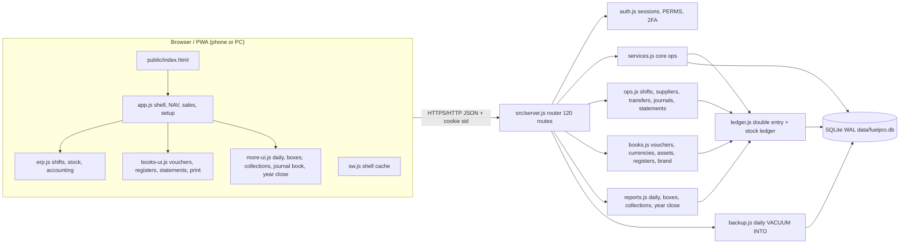

# ARCHITECTURE — FuelPro
Last verified 2026-11-24 (0.26.0) against `src/server.js`, `src/db.js`, `public/index.html`. Paths are relative to the project root.

## 1. System overview


## 2. Backend (verified)
- **No framework.** `node:http` server built in `createApp()` (`src/server.js`). Routes registered with
  `route(method, pattern, handler, {public})`; `:param` patterns compiled to regexes, first match wins.
- **Static files** (0.26): kept in memory per version (size + mtime), ETag = SHA-1 of the content, pre-compressed once
  (brotli q11, else gzip 9) → `304` on revalidation; `Cache-Control: no-cache` so a new version is picked up at once.
- **API answers** ≥ 1.4 KB are gzip-compressed (level 1, on the libuv thread pool) when the client sends `Accept-Encoding: gzip`;
  `Cache-Control: no-store` always. Both are skipped where `zlib` is absent (the Artifact page). Details: [PERFORMANCE](PERFORMANCE.md).
- **Request pipeline:** static files (GET only, path-traversal check) → route match (404/405) → CSRF check for writes
  (Origin host must equal Host; body must be `application/json`) → JSON body → session from cookie `sid`
  (`auth.loadSession`) unless `public` → handler → JSON reply. `HttpError` → its status; SQLite constraint → 409 `CONSTRAINT`; anything else → 500 `INTERNAL`.
- **Modules:**
  | File | Responsibility |
  |---|---|
  | `src/db.js` | `openDb`, 16 migrations (`PRAGMA user_version`; v16 = covering indexes), `tx()` with SAVEPOINT nesting |
  | `src/auth.js` | scrypt passwords, hashed sessions, `PERMS`/`ROLES`/`ORG_WIDE`, login throttling |
  | `src/services.js` | orgs/users/stations/fuels/tanks/pumps, sales, deliveries, expenses, payments, adjustments, scoping (`scoped`, `need`), audit, password reset, 2FA |
  | `src/ops.js` | shifts & cash moves, suppliers, transfers, stock moves/reconciliation, journals, trial balance, income statement, balance sheet, ledger, period lock, integrity check |
  | `src/books.js` | account tree, boxes, vouchers, currencies & revaluation, fixed assets & depreciation, sales register, purchases, monthly stock, profit by month, price history, brand, meter sheet |
  | `src/reports.js` | `dailyReport`, `boxReport`, `collections`, `yearClose`, `yearReopen` |
  | `src/ledger.js` | `CHART` system accounts, `post`, `reverse`, `reverseSource`, `stockMove` (weighted average), `assertOpen` (period lock) |
  | `src/money.js` | BigInt-safe `amountMinor`, `vatSplit`, `divRound` |
  | `src/backup.js` | backups (auto daily, keep 30), list/download for owner/admin |
  | `src/mailer.js`, `src/totp.js` | dependency-free SMTP client and RFC 6238 TOTP |
  | `src/validate.js`, `src/errors.js` | input validation and HTTP errors |

## 3. Frontend (verified)
- Single page, **no build step**. `public/index.html` loads, in order, `qr.js`, `i18n-erp.js`, `app.js`, `erp.js`, `books-ui.js`, `more-ui.js`; styles in `app.css`.
- `app.js` owns the shell: `h()` DOM helper, dictionary `D` (`[ar,en,fr]`), prefs (language, unit L/gal, Hijri calendar, theme),
  `api()` wrapper, `NAV` (groups gOps/gStock/gParties/gFinance/gAdmin), `render()`, `fitTables` (column auto-fit), `printNode`.
  Other files add screens to the shared `VIEWS` registry (`F.VIEWS.<key>`). Hash routing `#<key>`.
- PWA: `manifest.webmanifest`, `sw.js` caches the shell only (cache name `fuelpro-shell-v41`); data always from the server.
- Speed rules (0.26, [PERFORMANCE](PERFORMANCE.md)): numbers and dates through `FPFMT.nf / FPFMT.dt` (one cached `Intl` formatter per
  locale + options); `fitTables` checks overflow for all tables of a screen in 3 rounds (no layout per table); long lists
  (journal book 150, journal cards 25, statements and GL 500) show a first part + «show more / show all» (`data-expand`;
  the top-bar Excel export clicks it first; printing and PDF always use every row); `guard()` ignores a second submit/click
  while the first save is in flight; `boot()` shows the first screen only after every app script has registered its views
  (`DOMContentLoaded`, or `fp:app-loaded` from `web/runtime.js` in the Artifact page); `h()` applies `style` through the CSSOM
  (the CSP blocks `style=""` attributes).
- Print: `printNode` (app.js) and `F.printDoc` (books-ui.js) → unified letterhead from `org_brand`, A4, landscape for wide tables, 80 mm receipt for sale tickets. Font: Dubai → Segoe UI → Tahoma.

## 4. Data and integrity
SQLite in WAL mode, one file per installation. Integrity is enforced **in the database** (triggers on `journals`,
`journal_lines`, `stock_moves`; unique `client_id` per station; one open shift per station) and in code
(`tx()`, `L.post` balance check). Details: [DATABASE-SCHEMA](DATABASE-SCHEMA.md), [ACCOUNTING-RULES](ACCOUNTING-RULES.md).

## 5. Sale data flow
```mermaid
sequenceDiagram
  participant UI as sales screen
  participant S as server.js
  participant SV as services.js
  participant L as ledger.js
  UI->>S: POST /api/stations/:sid/sales {client_id, pump, close meter, pay_type}
  S->>SV: need(sale.create), scoped station
  SV->>SV: tx(): duplicate client_id? meter > last? stock? credit limit? period open? shift open?
  SV->>L: stockMove(tank, -qty) → cost at weighted average
  SV->>L: post(journal: Dr cash/AR, Cr sales + VAT; Dr COGS, Cr inventory)
  SV->>SV: audit row
  S-->>UI: 200 sale
```

## 6. Lifecycle and deployment
`npm start` → `createApp()` opens the DB (runs pending migrations), starts the backup timer, listens on `PORT` (3000).
On Windows `start-fuelpro.ps1` installs from `Downloads\fuelpro.zip`, picks the real or demo DB, opens the browser.
Cloud: `Dockerfile`, `render.yaml` (demo + production services), `/healthz`. → [DEPLOYMENT](DEPLOYMENT.md)

## 7. Known architecture limits and ideas (not implemented)
- One SQLite file means one server process; multi-server needs PostgreSQL (PLANNED, not started).
- `server.js` holds all 124 routes inline; a per-module route file would make the API easier to read (proposal only — no refactor without the owner's go-ahead).
- Local Git repo (branch `main`) since 2026-11-23; no remote. Cloud copies are still synced by hand (KI-02).
- Large UI files (`books-ui.js` 804 lines, `app.js` 600) have very long lines; diff-friendly formatting would help reviews.
