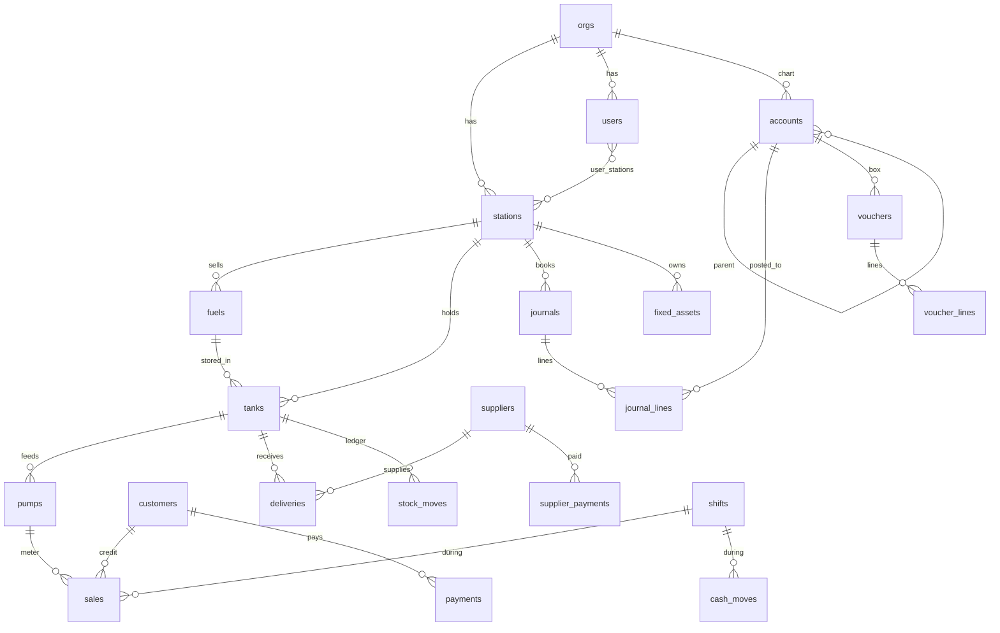

# DATABASE-SCHEMA — FuelPro
Engine: SQLite (built-in `node:sqlite`), WAL, foreign keys on. One file per install (`DB_PATH`, default `data/fuelpro.db`).
Migrations: `MIGRATIONS` array in `src/db.js`, applied at startup inside a transaction, tracked by `PRAGMA user_version` (= **12**, VERIFIED 2026-11-23).
Migration 3 rebuilt `users` with SQLite's 12-step procedure and opened the books from existing balances (tested: "upgrade from a v2 database").

**Full column list (generated, always exact): [DATABASE-SCHEMA.generated.md](DATABASE-SCHEMA.generated.md)** — refresh with
`node scripts/schema-doc.js > docs/DATABASE-SCHEMA.generated.md` after any migration.

## Tables by area (34)
| Area | Tables |
|---|---|
| Tenancy & identity | `orgs` (`locked_through`), `org_brand`, `users`, `user_stations`, `sessions`, `recovery_codes`, `reset_tokens`, `audit` |
| Station setup | `stations` (currency, `cur_dec`, `disp_dec`, timezone, `vat_bp`, `vat_included`, `allow_negative`, `require_shift`, `loss_tolerance_bp`), `fuels`, `price_history`, `tanks`, `pumps` |
| Operations | `sales`, `deliveries`, `expenses`, `payments`, `adjustments`, `transfers`, `shifts`, `shift_meters`, `cash_moves` |
| Parties | `customers`, `suppliers`, `supplier_payments` |
| Stock ledger | `stock_moves` |
| Accounting | `accounts`, `journals`, `journal_lines`, `vouchers`, `voucher_lines`, `currencies`, `exchange_rates`, `fixed_assets` |

## Integrity enforced by the database (VERIFIED)
- Triggers: `stock_moves_append_only_u/_d`; `journal_post_balanced`, `journal_no_unpost`, `journal_no_edit`, `journal_no_delete`, `jl_no_insert_posted`, `jl_no_update_posted`, `jl_no_delete_posted`.
- Unique: `users.email` (NOCASE), `sales(station_id, client_id)` idempotency, `accounts(org_id, code)` and `(org_id, sys)`, `exchange_rates(org_id, code, rate_date)`, `shifts_one_open` partial index (one open shift per station).
- Void columns on every document: `voided_at`, `void_reason`, `void_by` (rows are never deleted).

## Core relationships

Journals link back to their documents with `source` + `source_id` (no FK); reversal pairs via `reversal_of`/`reversed_by`.
Parties on journal lines: `party_type` + `party_id` (customer/supplier).

## Transactions
`tx(db, fn)` in `src/db.js`: `BEGIN IMMEDIATE` at the outer level, `SAVEPOINT` when nested; any throw rolls everything back.
